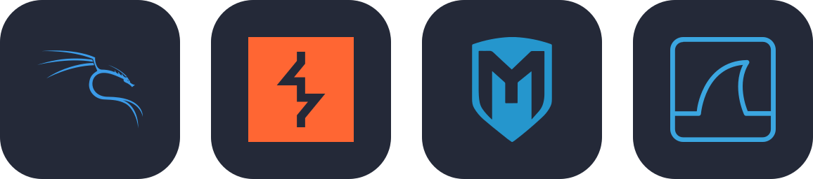
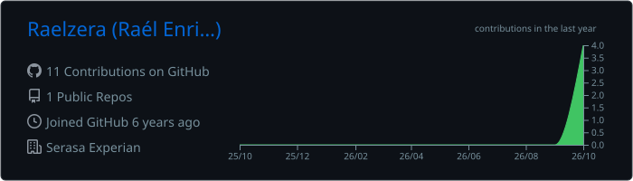
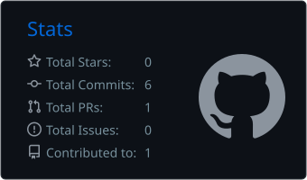
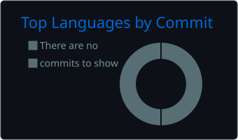

<!-- Header -->
<p align="center">
  
</p>

<p align="center">
  <a href="https://github.com/Raelzera">
    
  </a>
</p>

<p align="center">
  
  
</p>

---

### `> cat about.yaml`

```yaml
name: Raél
role: Senior Site Reliability Engineer
mission: "Reliable, observable and automated infrastructure — at scale."
focus:
  - Cloud infrastructure & Infrastructure as Code
  - Automation, CI/CD and eliminating toil
  - Linux, containers and observability
  - Information security & hardening
currently:
  learning: [Go, Kubernetes, Software Engineering]
  hacking_on: [Burp Suite, Metasploit, Wireshark]
philosophy: "Hope is not a strategy."
```

---

### `> ls ./stack`

<p align="center">
  
</p>

### `> ls ./learning`

<p align="center">
  
</p>

### `> sudo ls ./offensive-sec`

<p align="center">
  
</p>

---

### `> uptime --github`

<p align="center">
  
</p>

<p align="center">
  
  
</p>

<p align="center">
  
</p>

---

<p align="center">
  <code>SLO: 99.99% curiosity · 0% toil tolerated</code>
</p>

<p align="center">
  
</p>
